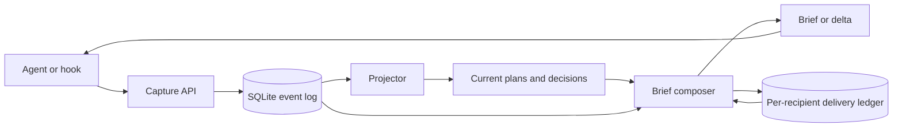

# Prebrief

**Give each agent the context it needs to join ongoing work.**

[](https://github.com/blakestone-x/prebrief/actions/workflows/tests.yml)
[](pyproject.toml)
[](LICENSE)

Prebrief records agent activity in SQLite and composes a brief for each
recipient: current work and standing decisions on first contact, then updates
based on what that recipient has already been sent. The delivery ledger keeps
repeated context from consuming the window.

**Local storage. No server to run. No runtime dependencies.**
The Python API works with your own harness; a Claude Code hook adapter is
included. This is an early-stage reference implementation with regression tests
and a reproducible synthetic benchmark.

[Try it](#try-it-in-a-few-minutes) · [How it works](#how-it-works) ·
[Evaluation](EVALUATION.md) · [Design paper](PAPER.md) ·
[Contributing](CONTRIBUTING.md)

## What changes for an agent

| Moment | Context |
|---|---|
| Joins ongoing work | Project brief, active builds, standing decisions, and task-matched build details |
| Continues working | Events since its watermark and eligible items it has not yet been sent |
| Catches up completely | A short `fleet unchanged` response |
| Starts a fresh context | A fresh recipient ID gets a new first-contact brief |

For example, a reviewer joining a billing export task can receive the current
plan and the decision to write UTF-8 CSV immediately. Later, a pagination
decision appears as an update. The reviewer can inspect the underlying state
instead of searching a transcript for the same facts.

## Try it in a few minutes

Requires **Git and Python 3.10+**. Install from this repository in a virtual
environment. The installation may download build tooling; the demo itself
needs no model, API key, or network connection.

```bash
git clone https://github.com/blakestone-x/prebrief.git
cd prebrief
python -m venv .venv
```

Activate the environment:

| Shell | Command |
|---|---|
| macOS / Linux | `source .venv/bin/activate` |
| Windows PowerShell | `.\.venv\Scripts\Activate.ps1` |

If PowerShell blocks activation, use `.\.venv\Scripts\python.exe` in place
of `python` below; no execution-policy change is needed.

```bash
python -m pip install .
python -I examples/quickstart.py
```

The [demo](examples/quickstart.py) creates a temporary database, records a
plan and decisions through the event API, projects them, and prints the
first brief and subsequent updates. It checks the delivery behavior and
cleans up its database on exit. It does not enroll hooks or touch your
normal Prebrief store.

To inspect correctness and reproduce the larger synthetic benchmark:

```bash
python -m unittest discover -s tests -v
python bench/bench.py
```

The benchmark writes `bench/bench_results.json`; its latency depends on your
machine. See [what these checks establish](EVALUATION.md).

## How it works



1. **Capture.** Record lifecycle events, plans, decisions, and tool telemetry.
2. **Project.** Fold logged plan and decision events into queryable state.
3. **Compose.** Select project-scoped context and fit it to a character budget.
4. **Track.** Record rendered references and event watermarks so later calls
   can send the next update.

Prefer the log-first API:

```python
from prebrief import Store, compose, make_decision, project_events

store = Store("example.db")
try:
    make_decision(
        store, "lead", "planning-session",
        subject="billing export",
        choice="Write UTF-8 CSV",
        project="billing",
    )
    project_events(store)
    print(compose(
        store, "billing:reviewer:context-1", "review-session",
        task="billing export", project="billing",
    ))
finally:
    store.close()
```

**Recipient identity matters.** The ledger is keyed by `agent_id`; changing
the `session` argument alone does not reset it. Use a unique agent ID for
each project and fresh context, and keep that ID stable while that context
continues. Composition records emission before the harness consumes the text;
the ledger is not an acknowledgment that the model read or used it.

**Projection is explicit.** Call `project_events(store)` after log-first
writes, or run `prebrief project`. The hook does not automatically fold
pending plan and decision events. Deprecated `client.plan` and
`client.decide` write directly to projections and do not survive a rebuild.

## Connect Claude Code

After trying the isolated demo, activate the environment used for installation:

```bash
prebrief init
prebrief enroll /path/to/your/project
```

On Windows, the project argument can be a quoted path such as
`"C:\dev\my-project"`. Enrollment updates that project's
`.claude/settings.json`, preserves unrelated hook groups, and backs up
existing settings. The generated command uses the enrolling Python interpreter;
keep that environment in place, or remove and re-enroll after moving it.

Use a stable project label: place a `.prebrief-project` file containing one
unique label in the project directory, or set `PREBRIEF_PROJECT` in the
environment inherited by Claude Code. Without an override, the directory
basename is used; same-named directories can collide. Give related worktrees
the same explicit label.

The adapter captures session starts/stops, tool names, paths, and a heuristic
tool-error flag. Task-aware build inlining is available when the Python API
receives a task on first contact; the hook's initial session brief has no task. It does not infer every plan or
decision from arbitrary tool output. Verify that your client loads the hooks
and receives context; installed settings alone do not prove live delivery.
See the [Claude Code hook reference](https://code.claude.com/docs/en/hooks).

```bash
prebrief doctor
prebrief brief --project my-project
prebrief enroll /path/to/your/project --remove
```

The default store is `~/.prebrief/prebrief.db`. Set `PREBRIEF_DB` to use
another path. `prebrief doctor --db /path/to/scratch.db` selects a specific
store and exits nonzero when diagnostics report an error. Opening a store
can create or migrate it, so use a copy when examining unfamiliar data.

Other harnesses can call the Python API and place the resulting string into
their context. There is no bundled Codex enrollment adapter.

## Evidence and boundaries

The [checked-in synthetic run](bench/bench_results.json) recorded **4,044 →
651 characters (6.2× smaller)** between its first and second payloads.
That is a payload-size observation on a seeded workload, not an agent
productivity result or a universal compression ratio.

[CI](https://github.com/blakestone-x/prebrief/actions/workflows/tests.yml)
checks Linux, Windows, and macOS with Python 3.10 and 3.12. It exercises
regressions, installation, the offline demo, diagnostics, and the benchmark.
The [evaluation notes](EVALUATION.md) separate these public checks from the
author's historical private-fleet observations.

- Designed for cooperating agents under one trusted operator. Project labels
  are application scoping, not authentication or a database access boundary.
- Payloads label captured text as untrusted data. This helps communicate
  provenance; it does not make prompt injection impossible.
- Capture and composition favor continuing the agent session after a failure.
  An empty payload or successful hook exit does not prove successful capture.
- Oversized deltas can attempt local Ollama curation; `prebrief assess` also
  contacts local Ollama. The optional benchmark LLM probe can use a remote
  provider. See [data handling and network behavior](SECURITY.md).
- No published controlled study in this repository establishes a causal
  improvement in live agent outcomes.

## Read the implementation

| Area | Entry point |
|---|---|
| Storage and migrations | [store.py](prebrief/store.py) |
| Log-first capture | [client.py](prebrief/client.py) |
| Deterministic projection | [projector.py](prebrief/projector.py) |
| Briefs, budgets, and delivery | [brief.py](prebrief/brief.py), [inject.py](prebrief/inject.py) |
| CLI and Claude Code adapter | [cli.py](prebrief/cli.py), [hook.py](prebrief/hook.py) |
| Regression coverage | [tests](tests) |
| Method and limitations | [EVALUATION.md](EVALUATION.md), [PAPER.md](PAPER.md) |

Built by [Blake Stone](https://github.com/blakestone-x). Released under the
[MIT license](LICENSE). Research citation metadata is in [CITATION.cff](CITATION.cff).
